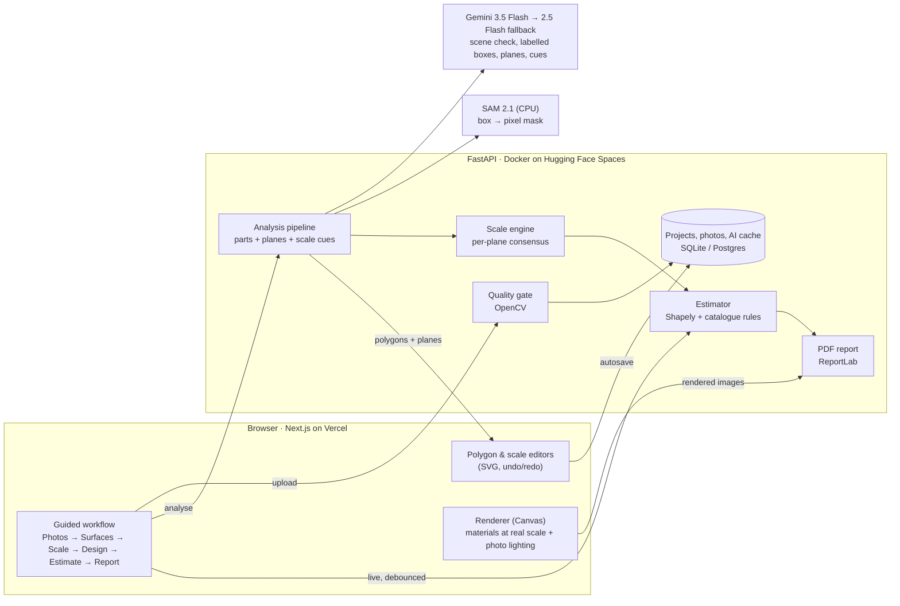

# FacadeAI: AI exterior renovation planner & cost estimator

Upload a photo of a house. FacadeAI identifies its walls, windows, balconies, pillars, parapets, gates and roof
edges; lets the owner try real materials and brand paint systems on **their own house**; measures every surface
with a confidence-rated scale; and produces a bill of quantities, a cost range and a PDF report for contractors.

| | |
| --- | --- |
| **Live app** | _https://YOUR-APP.vercel.app_ (filled in at deployment) |
| **API** | _https://YOUR-SPACE.hf.space/docs_ |
| **Access** | No login. Open the demo house, or upload your own photo. Projects are saved per browser; share links are read-only. |
| **Stack** | Next.js 16 · React 19 · TypeScript · Tailwind · FastAPI · Gemini 3.5 Flash · SAM 2.1 · OpenCV · Shapely · ReportLab · Playwright · GitHub Actions |

---

## 1. Features

| Area | What FacadeAI does |
| --- | --- |
| **Photo upload & checks** | JPG/PNG/WebP up to 12 MB, EXIF-rotated and normalised. **OpenCV** rejects too-small, dark, washed-out, low-contrast and blurry photos with specific instructions; **Gemini** flags photos that aren't a house, are obstructed or too far away, with tips to retake. Several photos per project. |
| **Structure detection** | **Gemini** labels each component (wall, window, door, balcony, railing, pillar, parapet, gate, roof edge/sunshade) and its **depth plane** (house front, house side, compound); **SAM 2.1** turns each box into a pixel-precise mask; OpenCV simplifies masks into **editable polygons**. Users drag/add/remove corners, retype, reassign planes, draw missing parts, with undo/redo. |
| **Materials & design** | **30 products in 7 categories**: brand paint systems (Asian Paints Ace / Apex / Apex Ultima / Ultima Protek, Berger WeatherCoat Long Life, Nerolac Excel Total, Dulux Weathershield Max), textures, **named stones** (Jaisalmer, Dholpur, Kota, slate, ledge-stone, granite), GVT elevation tiles by size, brick slips, ACP (PVDF / fire-retardant), HPL, WPC louvers, fibre-cement, four railing systems, metal enamel. Each has a tier, rate range, warranty claim, life, upkeep, pros/cons, specs and **the surfaces it suits**. A **120-shade exterior palette** (plus metal, ACP, HPL, WPC palettes) with families and search. Several named designs per project. |
| **Visualisation** | The user's actual photo is re-rendered with the chosen materials, **preserving the structure exactly**: textures at real-world scale (per plane, horizontally and vertically), the photo's own lighting re-applied, glass showing the new wall behind it, SS posts, tile joints, panel joints. After / Before \| After slider / Before. |
| **Measurement** | **Multi-cue, plane-aware scale**: each depth plane's scale is the robust consensus of reference cues (doors, cars, people, railings, the building's storey height, user-measured lengths), outliers rejected, impossible cues switched off, separate vertical/horizontal scales for angled walls, and a **confidence score** shown to the user. Openings and overlapping parts are deducted; hidden faces of pillars/gates can be included; site measurements override. |
| **Quantities** | Paint systems (primer, elastomeric base coat, top coats) rounded to **practical pack combinations**; texture compound in bags; cladding sqft + adhesive bags; **tiles and boxes**; ACP **sheets**; railings in running feet, all with wastage. |
| **Costing** | Material + labour per surface and category, **site & preparation items** (scaffolding, surface prep, waterproof base coat, removal of old finish, debris), contingency, GST, **city rate index**, all rates editable. A **most-likely total with a likely range**, design comparison, and a **BOQ export (CSV)** for contractors to price against. |
| **Reports** | Server-generated **PDF**: original vs redesigned photos, material schedule with shade names and planes, net areas and deductions, purchase quantities, site items, cost range, per-plane scale confidence, method, assumptions and exclusions. |
| **Platform** | Guided 6-step flow; responsive to phones; photos ≤1600 px; autosave (serialised, flushed on navigation) + undo; per-browser workspaces and read-only share links; stateless API with rate limiting and AI result caching; graceful degradation when an AI stage is unavailable. |

## 2. Architecture



* **AI and money logic live on the server.** One estimator (unit-tested) serves the live UI, the BOQ and the PDF, so the numbers always match. The scale algorithm is mirrored in the browser only for live editor feedback.
* **Rendering runs in the browser**: instant, free per render, and it never distorts the building.
* **Every AI stage degrades gracefully**: model fallback on overload; boxes if SAM is unavailable; manual drawing if Gemini is down; implausible scale cues are switched off rather than trusted.

## 3. User workflow

1. **Photos**: upload. Bad photos are rejected with reasons and tips; the AI's notes are shown.
2. **Surfaces**: AI-detected parts as coloured outlines. Fix type, outline, plane or name; draw anything missed; mark finishes to be removed.
3. **Scale**: one card per depth plane with its consensus scale, confidence badge, used/rejected cues and editable references (presets for door, gate, railing, storey, car, person; vertical / horizontal / both). Confirm when checked.
4. **Design**: click a surface, browse materials by category, tier, brand or search, pick a shade; the photo re-renders instantly. Keep several designs.
5. **Estimate**: likely total and range, warnings, per-surface lines with ranges, site items, measurement confidence, city, settings, editable rates, design comparison, **BOQ (CSV)**.
6. **Report**: PDF, redesigned photos, share link.

## 4. The AI pipeline

```
photo ─► OpenCV quality gate ─► Gemini ──────────────────────► SAM 2.1 (one batch) ─────────► editable polygons
         size, exposure,        usable house? parts + boxes,    parts → masks                   + depth planes
         contrast, blur         depth planes, scale cues        cues  → median column heights   + scale consensus
```

Choices were made by testing on real Indian house photos:

| Tried | Result | Decision |
| --- | --- | --- |
| Gemini 2.5 Flash boxes | Rough, overlapping boxes; mislabelled cues | fallback only |
| Gemini 3.5 Flash polygons | Too coarse | rejected |
| Gemini native masks | Internal mask tokens / time-outs | rejected |
| **Gemini 3.5 Flash boxes + SAM 2.1** | Tight boxes, pixel-accurate outlines | **chosen** |
| A single "door = 7 ft" scale | Wrong whenever the door is partly hidden | replaced by multi-cue consensus |
| Cue height = bounding-box height | Inflated by perspective (slanted railings) | replaced by SAM-mask median column height |

## 5. Scale & measurement (how areas are derived)

1. **Cues.** Every line of known or estimated real length is a cue: AI-detected doors (7 ft), cars (~5 ft), people (~5.4 ft), railings (3–3.5 ft), parapets, gates; the building's storeys (~10 ft each + plinth/parapet); and any length the user draws and types. Each cue's pixel length is measured on its SAM mask (median column height), not its bounding box.
2. **Sanity filters.** Cue boxes with impossible shapes (a "door" wider than tall, a sliver "storey") are discarded. On the house front, a cue that implies an impossible building height (a 2-storey house must be ~17–32 ft) is switched off and labelled, and the user can re-enable it.
3. **Consensus per plane.** `feet per pixel` = weighted median of the cues on that plane (auto cues weighted by type × AI confidence; user-measured cues weight 1); with ≥3 cues, any >35% from the median is rejected. Vertical and horizontal cues give separate `ftPerPx_y` and `ftPerPx_x`, which corrects foreshortening on angled walls. A plane without cues borrows another plane's scale at half confidence.
4. **Confidence & error.** Confidence grows with the number of agreeing cues and with user-measured or confirmed references, and falls with disagreement. It maps to an expected length error (shown per plane), which drives the cost range.
5. **Area.** `polygon pixel area × ftPerPx_x × ftPerPx_y`. Surfaces are stacked in layers (wall < roof edge < parapet < balcony < pillar < railing < gate < window/door); **net area = polygon minus everything layered above it**, so openings and things in front are never counted twice. The renderer uses the same layering. Railing length uses the long side of the minimum bounding rectangle, converted with both scales. Site measurements entered by the user override all of this.

## 6. Quantities, cost and range

| Material type | Purchase quantity | Labour on |
| --- | --- | --- |
| Paint system | top coat `net × coats ÷ coverage × (1+waste)` L, primer `net ÷ coverage × (1+waste)` L, optional elastomeric base coat; each rounded to a practical pack mix (minimises litres + packs) | net sqft |
| Texture | `net × kg/sqft × (1+waste)` → whole 25 kg bags | net sqft |
| Stone / brick cladding | `net × (1+waste)` sqft + `⌈net ÷ sqft per bag⌉` adhesive bags | net sqft |
| GVT tiles | `⌈net × (1+waste) ÷ tile area⌉` tiles → whole boxes + adhesive bags | net sqft |
| ACP | `⌈net × (1+waste) ÷ 32⌉` 4×8 ft sheets | net sqft |
| HPL / WPC / fibre cement / microcement | `net × (1+waste)` sqft | net sqft |
| Railings (installed systems) | `length × (1+waste)` running ft | running ft |

* **Site & preparation:** scaffolding on all house-plane surfaces in scope, surface prep on painted/textured area, optional waterproof base coat, removal on surfaces marked for it, debris as % of works.
* **City index:** labour and material rates are scaled for 12 cities (Ahmedabad = 1.00); user rate overrides are used as entered.
* **Totals:** `subtotal = material + labour + site`; `total = (subtotal + contingency%) × (1 + GST%)`.
* **Range:** each line's spread combines its material/labour **market rate range** and its plane's **measurement error** as root-sum-square (independent sources). The result is a concept-stage range comparable to an **AACE International Class 4–5 estimate**: around −25 % / +35 % for the demo, narrower as references are measured and confirmed.

**Worked example (demo, first-floor feature wall, Jaisalmer sandstone):** gross 324.7 sqft − 32.1 sqft window
= **292.6 sqft net** → ×1.10 waste = **321.9 sqft** at ₹140 + ⌈292.6 ÷ 30⌉ = **10 bags** adhesive at ₹480
= **₹49,867** material; 292.6 × ₹75 = **₹21,948** labour; likely range ₹54.5k–91.8k for the line.

**Rates** ([`catalog.json`](backend/app/data/catalog.json), generated by `backend/scripts/build_catalog.py`) are indicative 2026 figures excluding GST: dealer prices derived from published MRPs and market listings, and Ahmedabad labour rates, each with a low–high range. Brand names identify product classes for planning; confirm prices, coverage and warranty terms with dealers and data sheets.

## 7. How the redesign is rendered

Per surface, in layer order: anti-aliased polygon mask → material generated at real-world scale using the plane's
horizontal and vertical feet-per-pixel → the photo's lighting re-applied → alpha blend. Lighting is the local
**brightest envelope** of the photo (white-patch Retinex on a coarse grid, mask-aware), applied through a gamma curve.
The old surface's colours don't bleed through, while real shadows stay. Gates and railings keep fine shading. Glass
shows the newly finished wall behind it. Windows, doors and untouched surfaces keep their original pixels.

## 8. Limitations (honest)

* **Single-photo measurement is approximate.** The scale is now cross-checked and confidence-rated, but it can still be off if all cues on a plane are wrong. The UI shows the confidence, and a measured length on each plane (door, gate, wall width) brings the error to a few percent.
* **AI outlines need review.** SAM can merge neighbouring parts or produce ragged edges around clutter. The demo shows the AI result with two outlines corrected and one porch column added by hand.
* **The render is a planning visual**, not a photoreal render. No new geometry, no reflections, and textures are not perspective-warped within a plane.
* **Rates are indicative** and differ by dealer, quantity and season. Structural repairs, major damp treatment, electrical/plumbing work and permits are not included. Estimates are advisory, not quotations.
* **No accounts.** Projects are scoped to an anonymous per-browser workspace; share links are read-only. The free Space uses SQLite (resets on rebuild) unless `DATABASE_URL` points to Postgres.
* **Free-tier hosting.** The API sleeps when idle (about a minute to wake), and Gemini's free tier is sometimes overloaded (the app retries and falls back to 2.5 Flash).

## 9. Run locally

Requirements: Node 20.9+, Python 3.12+, a free Gemini API key (Google AI Studio).

```bash
# API (http://localhost:8000)
cd backend
python -m venv .venv && .venv/Scripts/activate          # macOS/Linux: source .venv/bin/activate
pip install torch==2.15.0 torchvision==0.29.2 --index-url https://download.pytorch.org/whl/cpu
pip install -r requirements-dev.txt
cp .env.example .env                                     # add GEMINI_API_KEY
uvicorn app.main:app --port 8000

# Web app (http://localhost:3000)
cd frontend
npm install
echo NEXT_PUBLIC_API_URL=http://localhost:8000 > .env.local
npm run dev
```

## 10. Tests & CI

```bash
cd backend && pytest -q                               # 57 tests: scale consensus, plausibility, estimator, geometry, quality, API, migration
cd frontend && npm run typecheck && npm run lint
cd frontend && npx playwright install chromium && npm run test:e2e   # 10 browser tests (app must be running)
E2E_AI=1 npm run test:e2e                             # also runs the live AI upload test (uses Gemini quota)
```

[GitHub Actions](.github/workflows/ci.yml) runs the backend tests, the frontend type check, lint and production
build, then starts the API and app and runs the Playwright suite (AI disabled, no quota used).

## 11. Project structure

```
backend/
  app/main.py, config.py, db.py, schemas.py, catalog.py
  app/api/                images (upload/analyse), projects, estimate + report
  app/services/           quality · gemini · segmenter (SAM) · analysis · scale · geometry · estimator · report
  app/data/catalog.json   products, palettes, site items, cities (from scripts/build_catalog.py)
  app/demo/               demo photo + project
  scripts/                build_catalog.py, build_demo.py, demo_designs.py
  tests/                  pytest suite
  Dockerfile              Hugging Face Space image (SAM weights baked in)
frontend/
  src/app/                routes: / and /p/[id]
  src/components/steps/   the six workflow steps
  src/components/design/  material browser, shade picker, design tabs
  src/lib/                API client, types, geometry + scale, renderer, store, BOQ export
  e2e/                    Playwright tests + fixtures
.github/workflows/ci.yml  CI pipeline
docs/                     deployment guide
```

## 12. Credits

* Demo and test photos: Timothy A. Gonsalves, [*Modern House, Eraviputhenthurai*](https://commons.wikimedia.org/wiki/File:Modern_House_Eraviputhenthurai_Mar24_A7C_10232.jpg), Wikimedia Commons, **CC BY-SA 4.0**. Redesigned previews are modified versions.
* Material textures: [ambientCG](https://ambientcg.com) (CC0). PDF font: Noto Sans (SIL OFL).
* Models: Google Gemini (API), Meta SAM 2.1 (`facebook/sam2.1-hiera-tiny`, Apache 2.0).
* Brand and product names belong to their owners and are used only to identify product classes for planning.
