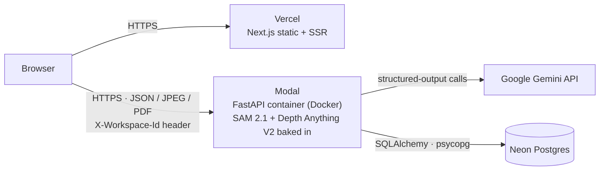
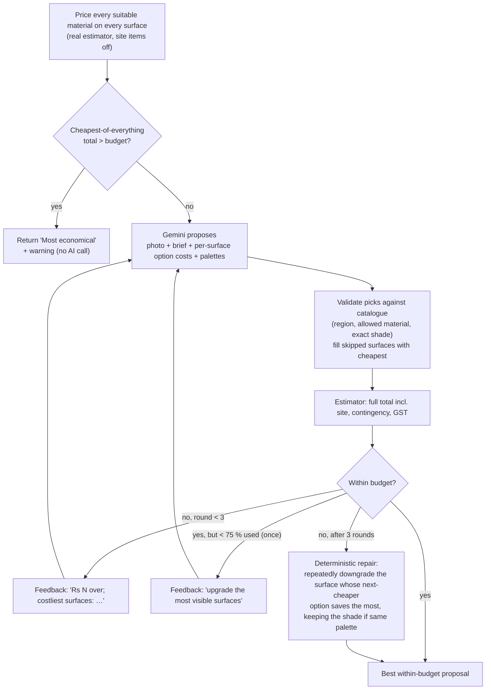

# FacadeAI: technical documentation

This document is for engineers who will review, run or extend FacadeAI. The [README](../README.md) gives the
product view (features, workflow, results); this document explains **how the system is built and why**: the
architecture, data model, API, each AI stage, the measurement and costing maths, failure handling, security,
testing and operations. File references point at the code that implements each part.

**Contents**

1. [System overview](#1-system-overview)
2. [Deployment topology](#2-deployment-topology)
3. [Backend architecture](#3-backend-architecture)
4. [Data model](#4-data-model)
5. [API reference](#5-api-reference)
6. [AI pipeline: photo to editable structure](#6-ai-pipeline-photo-to-editable-structure)
7. [Measurement engine](#7-measurement-engine)
8. [Estimation engine](#8-estimation-engine)
9. [AI budget designer](#9-ai-budget-designer)
10. [Frontend architecture](#10-frontend-architecture)
11. [PDF report](#11-pdf-report)
12. [Reliability: failure modes and fallbacks](#12-reliability-failure-modes-and-fallbacks)
13. [Security and privacy](#13-security-and-privacy)
14. [Performance and caching](#14-performance-and-caching)
15. [Configuration reference](#15-configuration-reference)
16. [Testing and CI](#16-testing-and-ci)
17. [Operations](#17-operations)
18. [Design decisions and trade-offs](#18-design-decisions-and-trade-offs)
19. [Known limitations and next steps](#19-known-limitations-and-next-steps)

---

## 1. System overview

FacadeAI turns **one ordinary photo of a house** into an editable model of its exterior surfaces, measures
them in real units, lets the owner apply real materials, and prices the work. The core problem is that a
single photo has no scale and no depth; most of the engineering goes into recovering both robustly and being
honest about the remaining uncertainty.

| Concern | Where it runs | Main code |
| --- | --- | --- |
| Photo validation, AI detection, segmentation, depth | API (Python) | `backend/app/services/{quality,gemini,segmenter,depth,analysis}.py` |
| Scale, quantities, costs, ranges, lifetime cost | API (Python), scale mirrored in browser | `services/{scale,geometry,estimator}.py`, `frontend/src/lib/{geometry,depth}.ts` |
| AI budget designer | API | `services/designer.py` |
| Editing, undo/redo, autosave | Browser | `frontend/src/lib/useProjectStore.ts`, `components/` |
| Redesign rendering | Browser (Canvas) | `frontend/src/lib/render.ts` |
| PDF report | API | `services/report.py` |
| Persistence | Postgres (Neon) or SQLite | `backend/app/db.py` |

**Guiding principles**

* **AI proposes, code decides.** Models detect, segment, estimate depth and suggest designs. Every number a
  user sees (area, quantity, rupee) comes from deterministic, unit-tested code. Every AI output is
  validated before it is used.
* **One source of truth for money.** The live estimate, the BOQ CSV, the AI designer and the PDF all call the
  same `estimate_project()` function.
* **Degrade, don't fail.** Every AI stage has a fallback (section 12). Without any AI at all, the user can still
  draw surfaces, set a scale and get an estimate.
* **Show uncertainty.** Each depth plane has a scale confidence and an expected error, and those drive the
  cost range.

---

## 2. Deployment topology



| Component | Host | Sizing | Notes |
| --- | --- | --- | --- |
| Web app | Vercel Hobby | static + edge | Root directory `frontend`; `NEXT_PUBLIC_API_URL` points at the API |
| API | Modal serverless | 2 vCPU, 4 GB, `max_containers=1`, 16 concurrent inputs | Same `backend/Dockerfile` as local; scales to zero after 600 s idle ([modal_app.py](../backend/modal_app.py)) |
| Database | Neon Postgres | free tier | Tables created on start-up; demo project seeded |
| LLM | Gemini API | free tier | Model chain `gemini-3.5-flash → gemini-2.5-flash → gemini-flash-latest` |

**Why one container.** Loaded models and the rate limiter live in process memory. One warm container serving
16 concurrent requests is enough for a planning tool. CPU-heavy inference is serialised by locks (section 14), so
extra containers would mainly multiply memory cost. Scaling out would need a shared rate limiter (Redis) first.

**Cold start.** About a minute: the container boots, then SAM and the depth model load from weights baked into the
image (`HF_HUB_OFFLINE=1`, so there are no downloads at runtime). The frontend's `useServerWake()` calls
`/api/health` and shows a "waking up" notice after 2.5 s.

Step-by-step deployment is in [DEPLOYMENT.md](DEPLOYMENT.md).

---

## 3. Backend architecture

FastAPI + Pydantic v2 + SQLAlchemy 2, Python 3.12. Layers:

```
app/main.py        application factory, lifespan (DB init, demo seed, model loaders, rate limiters), CORS, GZip
app/api/*          HTTP routes: validation, auth-by-workspace, rate limits, mapping errors to status codes
app/services/*     domain logic, no HTTP concerns: quality, gemini, segmenter, depth, analysis, scale,
                   geometry, estimator, designer, report, demo
app/schemas.py     Pydantic models shared by API, DB (as JSON) and services
app/catalog.py     typed loader for data/catalog.json (materials, palettes, site items, cities)
app/db.py          tables, engine (SQLite or Postgres), sessions
```

**Lifespan** ([main.py](../backend/app/main.py)): on start-up the app creates tables, seeds the demo project,
builds the Gemini client, and starts **background threads** that load SAM and the depth model. The API answers
`/api/health` immediately; `sam` and `depth` report `loading → ready | failed | disabled`.

**Concurrency model.** CPU-bound routes (`analyze`, `designs/suggest`) are plain `def`, so FastAPI runs them
in its worker thread pool and the event loop stays free. Shared resources are protected:

| Lock | Protects | Why |
| --- | --- | --- |
| `MODEL_LOAD_LOCK` ([segmenter.py](../backend/app/services/segmenter.py)) | loading SAM and depth models | `transformers` lazy imports are not thread-safe. Two loader threads importing at once raised `ImportError` in production. |
| `Segmenter._infer_lock` | SAM inference | one CPU inference at a time; parallel runs would only thrash 2 vCPUs |
| `DepthEstimator._lock` | depth inference | same |
| `depth_store._compute_lock` | depth computation + cache insert | a second request for the same photo waits, then finds the cached result. An `IntegrityError` on insert (another process won) is rolled back and ignored. |
| `RateLimiter._lock` | sliding-window deques | thread-safe counters |

---

## 4. Data model

### 4.1 Tables

| Table | Key | Columns | Purpose |
| --- | --- | --- | --- |
| `projects` | `id` (16 hex) | `owner_id`, `name`, `is_demo`, `data` (JSON text of `ProjectData`), timestamps | A project is one JSON document, saved whole |
| `images` | `id` (32 hex) | `owner_id`, `sha256`, `width`, `height`, `jpeg` (bytes), `quality` (JSON) | Normalised uploads (≤1600 px, EXIF stripped) |
| `analysis_cache` | `sha256` | `result` (JSON `AnalysisResult`) | Same photo is never analysed twice, whoever uploads it |
| `depth_cache` | `sha256` | `grid` (JSON `DepthGrid`) | Depth maps shared by editor and estimator |

Storing the project as a validated JSON document (instead of normalised tables) fits the access pattern: a
project is always loaded and saved whole by its owner, the editor needs the whole tree, and Pydantic
validators migrate old shapes on read (`Region._migrate_scale_id`, `View._migrate_scales`). There is no
migration tooling to run when the shape changes.

### 4.2 Project document (`ProjectData`, [schemas.py](../backend/app/schemas.py))

```
ProjectData
├── views[]                       one per photo
│   ├── image_id, width, height
│   ├── regions[]                 building components
│   │   ├── id, type (wall|window|door|balcony|railing|pillar|parapet|gate|roof_edge), label
│   │   ├── polygons[][]          normalised (x, y) ∈ [0,1]; several disjoint parts allowed
│   │   ├── source (ai|ai_box|user), confidence
│   │   ├── plane_id              which depth plane measures it
│   │   ├── face_factor (1–4)     hidden faces of pillars and gates
│   │   ├── area_override_sqft / length_override_ft   site measurements win
│   │   └── remove_existing       strip old finish first
│   ├── planes[]                  surfaces at similar distance
│   │   ├── kind (house_front|house_side|boundary|other), confirmed, fallback_plane_id
│   │   └── references[]          scale cues: p1, p2, real_length_ft, axis, source (auto|manual), weight, enabled
│   ├── quality, scene, pipeline  what the checks and AI reported
├── designs[]                     named material combinations
│   └── assignments{region_id → material_id, color, note}
├── active_design_id
├── rate_overrides{material_id → material_rate, labour_rate}
└── settings                      contingency %, GST %, coats, city, site items, horizon years, inflation %
```

* **All coordinates are normalised to the image**, so geometry is independent of display or render size.
* Region ids must be unique across all photos (validated), because designs key assignments by region id.
* The max project size is 2 MB of JSON (`413` above that).

### 4.3 Depth grid wire format

```json
{ "cols": 192, "rows": 144, "focal_norm": 0.9629, "model": "depth-anything/…", "cm": "<base64 little-endian uint16>" }
```

The long side is 192 cells; values are **whole centimetres** (clamped 30 cm to 500 m). Both Python and TypeScript
sample this exact integer grid with the same arithmetic, which is why the editor's live sizes equal the server
estimate to the decimal (section 7.5).

---

## 5. API reference

Base URL: `https://gopichand111333--facade-ai-api.us-east.modal.run`. Interactive OpenAPI docs are at `/docs`.

**Identity.** There are no accounts. The browser creates a random UUID once (`localStorage`) and sends it as
`X-Workspace-Id` (8–64 chars `[A-Za-z0-9-]`; the reserved value `demo` is refused). Writes require it; reads of a
project by id work without it (share links), returning `can_edit: false`.

**Errors** are JSON: `{"detail": {"message": "<user-facing text>", ...}}`, which the frontend shows as is.

| Method & path | Auth | Purpose | Notable responses |
| --- | --- | --- | --- |
| `GET /api/health` | – | Liveness + `gemini`, `sam`, `depth` status | |
| `GET /api/catalog` | – | Materials, palettes, site items, cities | |
| `POST /api/images` (multipart `file`) | required | Upload, normalise, quality-check | `201 ImageInfo`; `413` > 12 MB; `415` not JPG/PNG/WebP; `422` + `quality` report if unusable |
| `GET /api/images/{id}` | – | The normalised JPEG | immutable, 1-year cache |
| `GET /api/images/{id}/depth` | optional | Depth grid | cached → anyone; not cached → computed only for the owner, rate-limited; `404` if unavailable |
| `POST /api/images/{id}/analyze` | required | Full AI pipeline (section 6) | `AnalysisResult`; `403` not your photo; `429` limit; `503` Gemini busy |
| `GET /api/projects` | required | List my projects | |
| `POST /api/projects` | required | Create | `201` |
| `GET /api/projects/{id}` | optional | Open (also via share link) | `can_edit` tells the UI whether to allow edits |
| `PUT /api/projects/{id}` | owner | Save (autosave) | `403` not owner; `413` too large |
| `POST /api/projects/{id}/copy` | required | Copy into my workspace (how the demo and shared projects become editable) | `201` |
| `DELETE /api/projects/{id}` | owner | Delete | `204` |
| `POST /api/estimate` | – | Estimate for a design (stateless; works on unsaved edits) | `Estimate` |
| `POST /api/report` | – | PDF report; body includes browser renders as data URLs | `application/pdf`; renders ≤ 8 MB, ≤ 4096² px |
| `POST /api/designs/suggest` | required | AI budget designer (section 9) | `DesignSuggestion`; `422` no surfaces; `429`; `503` |

**Rate limits** (in-memory sliding window, 1 hour): 20 AI operations per workspace and 40 per IP, both
checked, so creating new workspace ids does not get around the limit. Analysis costs 1, computing a depth map
on request costs 1, and a design suggestion costs 3 (up to 3 model calls). Cached results cost nothing. The IP
is taken from `X-Forwarded-For` behind `TRUSTED_PROXY_HOPS` trusted proxies (Modal adds one): it is the n-th
entry from the right, since anything further left can be spoofed by the client.

---

## 6. AI pipeline: photo to editable structure

```mermaid
sequenceDiagram
  autonumber
  participant B as Browser
  participant A as API
  participant G as Gemini
  participant S as SAM 2.1
  participant D as Depth Anything V2
  participant DB as Postgres
  B->>A: POST /api/images (photo)
  A->>A: decode, EXIF-rotate, ≤1600 px, strip metadata, OpenCV quality gate
  A->>DB: store JPEG (dedupe by sha256 per owner)
  A-->>B: image_id + quality report
  B->>A: POST /api/images/{id}/analyze
  A->>DB: analysis_cache[sha256]?
  alt cached
    DB-->>A: result (+ ensure depth)
  else not cached
    A->>G: photo + prompt, JSON schema (fallback chain)
    G-->>A: scene, components (boxes, plane), scale cues
    A->>A: dedupe boxes (IoU > 0.85), plausibility filter for cues
    A->>S: one batch: component boxes + cue boxes
    S-->>A: masks + IoU scores
    A->>A: masks → simplified polygons; cue lines from mask column heights; auto planes
    A->>D: photo
    D-->>A: metric depth → 192-px cm grid
    A->>DB: cache analysis + depth
  end
  A-->>B: regions, planes, scene summary, pipeline trace
```

### 6.1 Upload normalisation ([images.py](../backend/app/services/images.py))

* JPG, PNG and WebP only; decompression-bomb guard (60 MP).
* EXIF orientation applied, long side ≤ 1600 px, re-encoded as JPEG q88.
* **All metadata is dropped except `FocalLengthIn35mmFilm`**, which the depth stage needs for the camera's
  field of view. GPS and device ids never reach storage.

### 6.2 Quality gate ([quality.py](../backend/app/services/quality.py))

Cheap, explainable OpenCV checks at a 1024 px working size, run before any AI call:

| Metric | Error (blocks) | Warning |
| --- | --- | --- |
| Shorter side | < 480 px | |
| Mean brightness | < 40 or > 225 | < 70; > 25 % pixels ≥ 250 |
| Contrast (std) | < 18 | |
| Sharpness (variance of Laplacian) | < 15 | < 100 |

Thresholds were tuned on sample house photos. Each issue carries a user-facing instruction ("Hold the phone
steady and tap to focus on the house").

### 6.3 Scene understanding: Gemini ([gemini.py](../backend/app/services/gemini.py))

One call with **structured output** (`response_schema=GeminiScene`, temperature 0.2) returns:

* scene checks: `is_residential_exterior`, `view_type`, `storeys`, `usable_for_renovation`, `issues`, `guidance`
* up to 40 `components`: `type`, `label`, `box_2d` ([ymin, xmin, ymax, xmax] on 0–1000), `plane`
* up to 12 `scale_cues`: `kind`, `box_2d`, `plane`, `real_height_ft` estimate, `confidence`

**Fallback chain.** Models are tried in order. A retryable error (429/500/503/504) gets one retry after 2 s, then
the next model is tried; unparseable output moves straight to the next model. If all fail →
`GeminiUnavailable` → HTTP 503 with "draw the regions manually". For 2.5-series models thinking is disabled
(`thinking_budget=0`), as Google recommends for detection tasks.

**Why boxes, not polygons.** Gemini 3.5 Flash's polygons were too coarse, and native mask output timed out
or returned internal tokens. Gemini localises boxes well, and SAM is the specialist for outlines (README §4 table).

### 6.4 Segmentation: SAM 2.1 hiera-tiny ([segmenter.py](../backend/app/services/segmenter.py), [analysis.py](../backend/app/services/analysis.py))

* Component boxes and plausible cue boxes go to SAM in **one batch** (`multimask_output=False`).
* A mask is accepted when the IoU score is ≥ 0.3 and it fills ≥ 12 % of its box (after clipping to the box + 2 %
  margin); otherwise the region falls back to the box itself (`source: "ai_box"`).
* **Mask → polygons** ([geometry.py](../backend/app/services/geometry.py)): morphological open/close (5 px
  ellipse), at most 4 parts, parts smaller than 8 % of the largest (or 0.03 % of the image) dropped,
  Douglas-Peucker simplification (tolerance 0.3 % of the image's longer side), so the user gets a handful of draggable corners rather than pixel stairs.

### 6.5 Scale cues

Gemini's cue boxes are filtered by **shape plausibility** before use: a door must have a height/width ratio of
1.5–3.6, a person 1.8–5, a car 0.2–1.0, and so on. Cues must be at least 3 % of the image height (2 % for railings
and parapets), and a "storey" must be at least 8 % of the height. Each kept cue's pixel height is measured on
its **SAM mask**: the median height of well-covered columns, drawn at the column closest to that median. A
bounding box would be inflated by perspective (a slanted railing has a tall box but a short real height).

`auto_planes()` ([scale.py](../backend/app/services/scale.py)) then builds one **plane** per depth group
(house front, house side, boundary, other), with cues as `ScaleReference`s:

| Cue | Default height | Trust |
| --- | --- | --- |
| door | 7.0 ft | 1.0 |
| car | 5.0 ft | 0.7 |
| railing | 3.5 ft | 0.7 |
| storey | 10.0 ft | 0.6 |
| person | 5.4 ft | 0.6 |
| parapet | 3.3 ft | 0.5 |
| motorbike | 3.6 ft | 0.5 |
| gate | 6.0 ft | 0.4 |
| window | 4.0 ft | 0.3 |

A cue's weight is `trust × clamp(AI confidence, 0.2, 1)`. Gemini's own height estimate (e.g. SUV 5.8 ft)
takes precedence over the default.

**Whole-building cue and plausibility check.** On the house front, the span of walls, parapets and roof edges
becomes a low-trust cue: `storeys × 10 + 3 ft`, weight 0.35. Any cue implying a building height outside
`[storeys × 8 + 1, storeys × 13 + 6]` ft is **switched off** but kept visible and labelled "implausible: implies
a 48 ft building". The user can re-enable it. Planes without cues get `fallback_plane_id` pointing at the house
front.

### 6.6 Depth: Depth Anything V2 Metric Outdoor Small ([depth.py](../backend/app/services/depth.py))

* Runs through the `transformers` depth-estimation pipeline on CPU and returns metric depth in metres.
* The output is box-resampled to a 192-px-long-side grid and stored as integer cm (section 4.3).
* `focal_norm = (f35 / 36) × max(W, H) / W`, where `f35` is the EXIF 35 mm-equivalent focal length, or
  **26 mm** (a typical phone main camera) when absent.
* The Small variant is used because it is **Apache-2.0**; Base/Large are CC-BY-NC.

### 6.7 Pipeline trace

Every analysis returns a `pipeline` dict, for example:

```json
{
  "gemini_model": "gemini-2.5-flash",
  "gemini_primary": "gemini-3.5-flash",
  "sam_model": "facebook/sam2.1-hiera-tiny",
  "components_detected": 21,
  "scale_cues": 6,
  "scale_cues_rejected": 1,
  "gemini_s": 31.2,
  "sam_s": 7.4,
  "depth_model": "depth-anything/…",
  "depth_s": 2.1
}
```

The UI shows it in the Photos step (`PipelineTrace.tsx`), so a fallback (here, 3.5 Flash was overloaded) is visible
rather than silent.

**Caching rule.** An analysis is cached only if it is complete: it has regions, and SAM either ran or is
deliberately disabled. A box-only result produced while SAM was still loading is not cached, so the next
request gets real outlines.

---

## 7. Measurement engine

Goal: convert each region's pixel polygon into square feet (or running feet for railings), on a photo with
perspective, several distances and imperfect references.

### 7.1 From a reference to a scale

For a reference line of `px` pixels and known length `L` ft, `fpp = L / px` (lines under 8 px are ignored).
With a depth map, each sample is **normalised by its own distance** `z` (median of the depth at 10/30/50/70/90 %
along the line):

```
sample = fpp / z        (feet per pixel per metre)
```

For a pinhole camera, feet-per-pixel is proportional to distance, so a door at 12 m and a railing at 16 m give
the same normalised value if both lengths are right.

### 7.2 Consensus per plane (`plane_scale`)

1. Split samples into vertical and horizontal sets (a `free` reference counts in both).
2. Take the weighted median of each set (auto cues use their weight; manual references weigh 1).
3. With 3 or more samples, reject any more than **35 %** away from the median, then recompute the weighted median.
4. `spread` = weighted mean relative deviation of the kept samples.
5. A missing axis takes the other axis's value. Separate x/y scales correct the horizontal foreshortening of
   an angled wall when a horizontal reference exists.
6. The scale is expressed at the cues' median distance `z0` (`ref_depth_m`), so `ft/px` reads naturally.

**Confidence**

```
c = (0.75 if any manual reference else 0.35) + 0.12 × min(n_used − 1, 3)
c = c × max(0.3, 1 − 2 × spread)
if plane.confirmed: c = max(c, 0.9)
c = min(c, 0.97)
```

**Expected length error**: `e = 0.04 + 0.3 × (1 − c) + spread`. Area error is `min(0.6, 2e)`, because area
scales with length squared. A site override has 3 % error; an unscaled surface has 50 %.

### 7.3 Planes without references

1. **Borrow** the fallback plane's scale. With depth it is distance-corrected, so confidence × 0.8; without
   depth it is the same scale at a different distance, so confidence × 0.5.
2. **Camera-only**: with no reference anywhere, use the depth model's metric distance and the focal length,
   `fpp = 3.28084 / (focal_norm × W) × z0`, at confidence 0.3. This scale is never lent to another plane and
   never used in consistency checks.

### 7.4 Measuring a surface at its own distance

* **Region distance** = median depth of the grid cells where the region is the **visible top layer** (layer
  order below). A wall behind a pillar is not pulled forward by the pillar. If the region has no visible
  cell, all its cells are used; failing that, its bounding-box centre.
* `fpp_region = fpp_plane × (z_region / ref_depth_m)` (`PlaneScale.at_depth`).
* **Layering** (`LAYER_PRIORITY`): wall 10 < roof edge 40 < parapet 50 < balcony 60 < pillar 70 < railing 80 <
  gate 90 < window/door 100; ties go by list order. **Net area = polygon minus the union of everything above
  it** (Shapely), so openings and things in front are never counted twice. The renderer uses the same order.
* `area_sqft = net_px² × fpp_x × fpp_y × face_factor`.
* Railings: long side of the minimum-area bounding rectangle, `√((dx·fpp_x)² + (dy·fpp_y)²)` running ft.

**Cross-plane consistency.** All planes share one camera, so their distance-normalised vertical scales
(`fpp_y / ref_depth_m`) should agree. A spread above 30 % produces the warning "one of their reference lengths
is probably wrong". Borrowed and camera-only scales are excluded, since they cannot disagree independently.

### 7.5 Browser parity

`frontend/src/lib/geometry.ts` and `depth.ts` mirror `scale.py` and `depth.py` exactly: the same cell lookup,
the same even-odd ray-casting point-in-polygon, the same medians on the same integer grid. Parity was verified
on all 21 regions of the demo house, so the size the editor shows while dragging a corner equals the
estimate's figure.

### 7.6 Rejected approach

Recovering each wall's **angle** from the depth map (RANSAC plane fit on back-projected points) gave errors up
to ±20° on real photos. The cosine correction would distort areas more than it fixed, so angled walls rely on
horizontal references instead (README §4).

---

## 8. Estimation engine

`estimate_project(data, catalog, design_id, depths)` in [estimator.py](../backend/app/services/estimator.py)
is a pure function of the project, catalogue and depth maps. It is stateless and is called by the live UI,
comparison, designer, BOQ and PDF.

### 8.1 Per line (one region with a material)

1. **Measure** (section 7) → unit, gross, net, source (`photo | override | unscaled`), error.
2. **Rates**: catalogue rate and low–high range × city index (material index and labour index separately),
   unless the user overrode a rate (then it is used as is, with no range).
3. **Quantities and material cost** by the material's `calc` type:

| calc | Purchase quantity | Material cost |
| --- | --- | --- |
| `paint` | top coat `net × coats ÷ coverage × (1+waste)` L; primer `net ÷ primer coverage × (1+waste)` L; optional base coat | litres actually **bought** in packs (see below) × rate |
| `texture` | `net × kg/sqft × (1+waste)` kg → whole bags | bags × bag kg × rate |
| `cladding` | `net × (1+waste)` sqft + `⌈net ÷ sqft per bag⌉` adhesive bags | sqft × rate + bags × adhesive rate |
| `tiles` | `⌈net × (1+waste) ÷ tile area⌉` tiles → whole boxes | boxes × tiles/box × tile area × rate + adhesive |
| `sheet` | `⌈net × (1+waste) ÷ 32⌉` 4×8 ft sheets | sheets × 32 × rate |
| `area` | `net × (1+waste)` sqft | sqft × rate |
| `railing` | `rft × (1+waste)` | rft × rate |

**Pack optimisation** (`choose_packs`): a dynamic programme over litres finds, for each total volume, the
fewest packs that make it exactly. It then picks the volume ≥ need that minimises `litres + pack_count`. Each
extra tin is treated as costing about a litre, so 47 L → 2×20 + 2×4 (48 L, 4 packs) rather than 2×20 + 4 + 3×1
(47 L, 6 packs). Counts use `ceil(round(x, 6))`, so float noise never buys an extra tile.

4. **Labour** = net sqft (or rft) × labour rate.
5. **Range**. Rate uncertainty and measurement uncertainty are independent, so they combine as root-sum-square:

```
low  = total × (1 − √(rate_down² + e²))
high = total × (1 + √(rate_up²   + e²))
```

6. **Lifetime (future) cost** over `horizon_years` with yearly inflation `g = 1 + inflation%`:

```
future = Σ_{y=1..H} installed × upkeep% × g^y
       + Σ_{k: k·R ≤ H − 0.5} installed × renew_share × g^(k·R)
```

`R` is the material's renewal interval (repaint every 7 years, reseal every 5...). A renewal due in the final
months of the horizon is left out.

### 8.2 Site items and totals

Site and preparation items (scaffolding, surface preparation, waterproof base coat, removal of old finish, debris) are
priced from measured bases: house-plane sqft, coated sqft, base-coat sqft and removal sqft. Systems with
their own base coat are not charged twice. Debris is a percentage of the works.

```
subtotal    = material + labour + site
contingency = subtotal × contingency%
GST         = (subtotal + contingency) × GST%
grand total = subtotal + contingency + GST
range       = (Σ line low/high + Σ site low/high) × (1 + contingency%) × (1 + GST%)
lifetime    = grand total + Σ future × (1 + GST%)
```

**Warnings** come from data, not guesses:
* a surface over 2,500 sqft (probably a wrong scale);
* a plane with no reference;
* confidence below 50 % on an unconfirmed plane;
* cross-plane inconsistency;
* a material not usually used on that surface type;
* unassigned surfaces.

The catalogue ([catalog.json](../backend/app/data/catalog.json)) is generated by
`backend/scripts/build_catalog.py`. It contains:
* 30 products with tier, rate and labour ranges, coverage, pack sizes, waste and lifecycle fields
  (`renew_years`, `renew_share`, `upkeep_pct`);
* 120+ shades;
* site items;
* 12 city indices.

---

## 9. AI budget designer

`POST /api/designs/suggest` with `{data, budget, style}` → a complete design within the budget, with a reason
per surface. Implemented in [designer.py](../backend/app/services/designer.py) as a **bounded agentic loop with
a deterministic verifier**:



* The model chooses **only taste**: which material and shade suit which surface for this house and brief. Ids
  and shades are validated, invalid picks are counted and replaced, and every rupee comes from the estimator.
* Prices given to the model are **real installed costs for that surface's measured area**, so the model
  reasons about trade-offs ("Jaisalmer stone on the feature wall costs Rs 1.0 L").
* Temperature 0.6, for design variety. If a later round fails (Gemini down), the earlier verified proposal is
  kept. If the first round fails, the request returns 503.
* `steps[]` in the response logs each round's total and whether it was within budget. The UI shows this
  trace and each surface's reason (`Assignment.note`).
* Privacy: only the requester's own photo (or the demo photo) is sent to the model.

---

## 10. Frontend architecture

Next.js 16 (App Router), React 19, TypeScript, Tailwind 4. No UI framework or state library beyond `immer`.

| Path | Role |
| --- | --- |
| `src/app/page.tsx`, `src/app/p/[id]/page.tsx` | Home (upload, demo, my projects) and workspace route; `/p/demo` opens the demo |
| `components/workspace/*` | Workspace shell: top bar, step navigation, view switcher, context |
| `components/steps/*` | The six steps: Photos, Surfaces, Scale, Design, Estimate, Report (+ `PipelineTrace`) |
| `components/stage/*` | The photo stage: SVG region overlay with draggable corners, rendered preview, before/after slider |
| `components/design/*` | Material browser, shade picker, design tabs, `AiDesigner` |
| `lib/api.ts` | Typed client; adds `X-Workspace-Id`; maps error bodies to `ApiError` (with quality report) |
| `lib/useProjectStore.ts` | Project state: immer updates, undo/redo (60 steps), debounced autosave |
| `lib/geometry.ts`, `lib/depth.ts` | Mirror of the server's scale and depth sampling (section 7.5) |
| `lib/render.ts` | Canvas renderer |
| `lib/hooks.ts` | `useCatalog`, `useEstimate` (debounced 350 ms), `useDesignComparison`, `useServerWake` |
| `lib/boq.ts` | BOQ CSV export from the server estimate |

**State and saving.** `update(fn)` produces a new immutable `ProjectData` and records an undo step. During a
drag, `checkpoint()` runs once on pointer-down and moves use `{record: false}`, so one drag is one undo step.
Autosave is debounced at 1.2 s and serialised (one PUT in flight; a newer change waits), and it is flushed on
navigation. Read-only projects (share links) never save.

**Depth on the client.** `useViewDepth` fetches `/api/images/{id}/depth` once per photo and caches only
successful results. If the depth is not ready yet (model loading after a cold start), it retries with backoff
10, 20, 40, 60, 120 s.

**Renderer** (`render.ts`, all in the browser, so it is instant and costs nothing per render). For each region,
in layer order:
1. Draw an anti-aliased polygon mask.
2. Generate the material texture at real-world scale, using the region's own `fpp_x`, `fpp_y` at its distance.
3. Re-apply the photo's lighting. Lighting is the local **brightest envelope** (white-patch Retinex on a coarse,
   mask-aware grid) through a gamma curve, so old colours don't bleed through while real shadows stay. Gates and
   railings use a fine, detail-keeping variant.
4. Alpha-blend.

Windows, doors and untouched surfaces keep their original pixels; glass shows the new wall behind it. For the
PDF, `renderToDataUrl` produces each view at ≤ 1600 px and sends it to `/api/report`.

---

## 11. PDF report

[report.py](../backend/app/services/report.py) (ReportLab, Noto Sans for the ₹ sign) builds the report from
the same `Estimate` object. It contains:
* original and redesigned photos;
* a material schedule with shade names and planes;
* net areas and deductions;
* purchase quantities;
* site items;
* category totals;
* the cost range and 15-year lifetime row;
* per-plane scale confidence and expected error;
* the method (including whether depth correction was used);
* assumptions and exclusions.

Browser renders are validated server-side: data-URL format, base64, ≤ 8 MB, a pixel count checked **before**
decoding, and re-encoding as JPEG.

---

## 12. Reliability: failure modes and fallbacks

| Failure | Detection | Behaviour |
| --- | --- | --- |
| Gemini overloaded or rate-limited | 429/5xx | retry once, then the next model in the chain; the trace shows the model used |
| All Gemini models fail | `GeminiUnavailable` | 503 + "draw the regions manually"; manual tools always work |
| Gemini returns malformed JSON | Pydantic validation | next model |
| SAM still loading / failed | `segmenter.status` | waits up to 60 s, then box polygons (`ai_box`) + warning; result not cached |
| A SAM mask is poor | score < 0.3 or fill < 12 % | that region uses its box |
| Depth model unavailable | `depth.status` | one scale per plane (no distance correction); the client retries fetching later; a cached analysis gains depth when it becomes available |
| Implausible cue | aspect / building-height checks | discarded or switched off (visible, re-enableable) |
| Plane without cues | no samples | borrow (×0.8 / ×0.5 confidence), then camera-only (0.3) |
| References disagree | outlier rule, consistency check | outliers rejected; warning shown |
| AI designer over budget | estimator | feedback rounds, then deterministic repair |
| Designer round 2/3 fails | exception | keep the earlier verified proposal |
| Concurrent depth requests | lock + IntegrityError | computed once; the duplicate insert is ignored |
| Cold start | health check > 2.5 s | "waking up" notice; requests succeed after load |
| Old saved project shape | Pydantic `model_validator(mode="before")` | migrated on read |

---

## 13. Security and privacy

* **Secrets**: `GEMINI_API_KEY` and `DATABASE_URL` live only in the host's secret store (Modal secret
  `facade-api`) or a local, git-ignored `.env`. Nothing secret is in the image or the repo.
* **Authorisation**: projects are owned by a workspace id. Writes check ownership (403 otherwise). Share links are
  read-only, and editing them requires an explicit copy. AI analysis runs only on your own (or the demo) photo; the
  designer sends only your own photo to Gemini.
* **Abuse and quota**: per-workspace and per-IP hourly limits on every AI operation, proxy-aware IP
  resolution, and cached results are free.
* **Input hardening**:
  * upload size cap (12 MB) read with a bound;
  * format allow-list;
  * decompression-bomb limits on uploads and renders;
  * project JSON ≤ 2 MB;
  * Pydantic bounds on every numeric setting (GST 0–28 %, coats 1–4, budget ≤ 1e9...);
  * region-id uniqueness;
  * CORS restricted to configured origins (plus an optional regex for Vercel previews).
* **Privacy**: uploads are re-encoded and every metadata field except the 35 mm focal length is removed (no GPS,
  no device ids).
* **Limitation**: anonymous workspaces are a deliberate choice for a no-sign-up planning tool. Production would
  put real authentication (OAuth/OIDC) behind the same `require_workspace` dependency (one function in
  [deps.py](../backend/app/api/deps.py)).

---

## 14. Performance and caching

| Item | Typical time (2 vCPU) | Mitigation |
| --- | --- | --- |
| Gemini scene analysis | 20–60 s (free tier, varies) | cached by image hash; shown as a progress step |
| SAM 2.1 tiny, one batch of ~25 boxes | ~7 s | one batch for parts and cues; models preloaded |
| Depth Anything V2 Small | ~2–4 s | cached by hash; 192-px grid (a few KB) shipped to the browser |
| Estimate | tens of ms | pure function; debounced 350 ms in the UI |
| AI designer | 1–3 Gemini calls + many estimator calls | options priced once per material (one estimator pass each) |
| Render | in the browser, < 1 s per view | textures and sampled lighting cached |

Other measures:
* Images are served with `Cache-Control: immutable` for one year (content never changes for an id).
* Responses over 1 KB are gzip-compressed.
* Uploads are deduplicated per owner by SHA-256.

---

## 15. Configuration reference

Backend settings ([config.py](../backend/app/config.py)), from environment variables or `.env`:

| Variable | Default | Meaning |
| --- | --- | --- |
| `GEMINI_API_KEY` | – | Required for AI detection and the designer |
| `GEMINI_MODELS` | `gemini-3.5-flash,gemini-2.5-flash,gemini-flash-latest` | Fallback chain, in order |
| `GEMINI_TIMEOUT_S` | 90 | Per-call timeout |
| `ENABLE_SAM` / `SAM_MODEL_ID` / `SAM_THREADS` | true / `facebook/sam2.1-hiera-tiny` / 2 | Segmentation (threads also used by depth) |
| `ENABLE_DEPTH` / `DEPTH_MODEL_ID` | true / `depth-anything/Depth-Anything-V2-Metric-Outdoor-Small-hf` | Depth model |
| `DATABASE_URL` | `sqlite:///./data/facade.db` | `postgres://` URLs are normalised to `postgresql+psycopg://` |
| `CORS_ORIGINS` / `CORS_ORIGIN_REGEX` | `http://localhost:3000` / – | Allowed web origins |
| `MAX_UPLOAD_MB` / `MAX_IMAGE_SIDE` | 12 / 1600 | Upload limits |
| `ANALYZE_LIMIT_PER_HOUR` / `ANALYZE_IP_LIMIT_PER_HOUR` | 20 / 40 | AI rate limits |
| `TRUSTED_PROXY_HOPS` | 0 (1 on Modal) | Proxies that append to `X-Forwarded-For` |

Frontend: `NEXT_PUBLIC_API_URL` (default `http://localhost:8000`).

---

## 16. Testing and CI

| Suite | Count | Covers |
| --- | --- | --- |
| `backend/tests` (pytest) | **78** | scale consensus, outliers, borrowing, camera-only, depth-normalised scale, region depths, consistency warning; quantities per calc type, pack optimisation, ranges, site items, lifetime cost; geometry and layering; quality checks; API (upload, ownership, rate limits, proxy IP, cache, migration); AI designer loop (fake Gemini: over budget → feedback → repair, upgrade round, invalid picks, later-round failure) |
| `frontend/e2e` (Playwright) | **13** (2 need live AI) | home, bad-photo rejection, design switching, material + shade, corner drag + undo, scale planes, depth-aware sizes, estimate (range, site items, city, BOQ), PDF download, navigation regressions, live upload + AI pipeline, live AI designer |

Tests run without GPUs, models or API quota. SAM and depth are disabled in `conftest.py`, and Gemini is replaced by
a fake that returns fixed structured output. The demo project ships with a precomputed depth map
(`app/demo/depth.json`), so depth-aware e2e tests run in CI too.

**CI** ([ci.yml](../.github/workflows/ci.yml)) on every push and PR:
1. backend pytest;
2. frontend `typecheck`, `lint`, production `build`;
3. e2e: start the API (AI disabled) and the built app, then run Playwright.

```bash
cd backend && pytest -q
cd frontend && npm run typecheck && npm run lint
cd frontend && npm run test:e2e                         # app running locally
E2E_AI=1 E2E_BASE_URL=https://… npm run test:e2e  # include live-AI tests (uses Gemini quota)
```

The full suite including the live AI tests has been run against the deployed site (13/13).

---

## 17. Operations

* **Deploy the API**: `cd backend && modal deploy modal_app.py`, or the *Deploy API* workflow when
  `MODAL_TOKEN_ID/SECRET` repository secrets are set. **Web**: Vercel deploys every push to `main`.
* **Health**: `GET /api/health` → `{"status":"ok","gemini":"configured","sam":"ready","depth":"ready",...}`.
* **Logs**: Modal dashboard (app `facade-ai`). Gemini fallbacks, SAM/depth load times and failures are logged
  at WARNING/INFO.
* **Caches**: delete rows from `analysis_cache` / `depth_cache` to force re-analysis after a pipeline change.
  Analyses that fail to validate against the current schema are re-run automatically.
* **Catalogue update**: edit `backend/scripts/build_catalog.py`, run it to regenerate `catalog.json`, and commit.
* **Demo update**: `scripts/build_demo.py`, `build_demo_depth.py`, `demo_designs.py`.

---

## 18. Design decisions and trade-offs

| Decision | Alternative considered | Reason |
| --- | --- | --- |
| Gemini boxes + SAM masks | Gemini polygons / native masks | Measured: polygons too coarse, masks unreliable; SAM is accurate and free on CPU |
| Weighted-median consensus with outlier rejection | Single reference ("door = 7 ft") | One partly hidden door ruined the whole estimate; a median of several cues is robust |
| Depth-normalised scale | One scale per plane | A set-back wall measured with a nearer railing's scale lost ~30–50 % of its area |
| Integer-cm grid shared with the browser | Server-only measurement | Live editing feedback without a round trip, identical numbers |
| No wall-angle recovery | RANSAC plane fit on depth | ±20° error on real photos; horizontal references are more reliable |
| Client-side renderer | Generative image model | Never distorts the building, instant, free; the free tier has no image-generation quota anyway |
| LLM chooses, estimator verifies | LLM computes the price | LLM arithmetic and catalogue recall are unreliable; verification makes the budget a guarantee |
| Project as one JSON document | Normalised tables | Always loaded and saved whole; schema evolves via validators |
| Anonymous workspaces | Accounts | No sign-up friction for a planning tool; auth is a single dependency to swap |
| Modal serverless (one container) | Always-on VM, HF Spaces | Free, 4 GB RAM for models, scales to zero; HF Docker Spaces now paid |
| Depth Anything V2 **Small** | Base / Large | Apache-2.0 licence (the larger ones are non-commercial) |

---

## 19. Known limitations and next steps

**Limitations** (also in README §8):
* Single-photo measurement is approximate: confidence-rated, but wrong if every cue is wrong or depth misjudges
  glass and reflections.
* There is no per-surface angle recovery.
* The render is a planning visual, not photoreal: no new geometry and no perspective-warped textures within a plane.
* Rates are indicative.
* The rate limiter is in memory, so it resets on restart and assumes one container.
* There are no real user accounts.

**Next steps**
1. **Accuracy benchmark**: photos of houses with tape-measured surfaces, to report the real measurement error
   per confidence band and calibrate `scale_error()`.
2. **Multi-photo fusion**: use several photos of the same facade to cross-check scales and recover angles.
3. **Perspective-correct texturing**: a per-plane homography from detected window/door rectangles.
4. **Shared rate limiting and job queue** (Redis): to run more than one container and process analysis
   asynchronously with progress events.
5. **Accounts** (OIDC) and project sharing with edit rights.
6. **Live price feeds** for catalogue rates per city.
